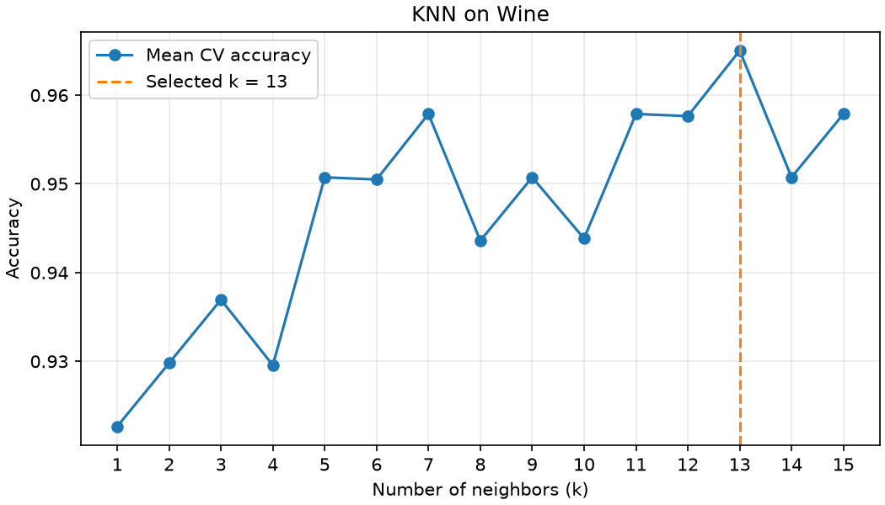

# Wine 数据集上的 KNN 分类

使用 scikit-learn 内置的 Wine 数据集，共 178 个样本、13 个特征和 3 个类别。算法用 NumPy 实现，scikit-learn 用于加载数据、划分数据、标准化和计算指标。

## 运行

在仓库根目录运行以下命令。本次实验在 Python 3.12 下验证。

```sh
python -m pip install -r requirements.txt
python main.py
```

`knn.py` 实现算法，`main.py` 运行实验。程序打印各个 k 的评估结果，并在代码目录更新图表。实验固定随机种子为 42。

## 实验方法与结果

KNN 按平方欧氏距离取最近的 k 个训练样本，再以多数投票预测类别。数据按 80% 和 20% 分层划分，得到 142 个训练样本和 36 个测试样本。只在训练集上进行 5 折分层交叉验证，比较 k=1～15 的平均准确率和宏平均 F1。每折的标准化参数只由该折的训练数据计算。

**选择 k=13。** 该值的交叉验证平均准确率最高，为 96.50%，宏平均 F1 为 96.53%。选定后用完整训练集拟合标准化器和分类器，再评估测试集。

| 测试集指标 | 得分 |
| --- | ---: |
| 准确率 Accuracy | 100.00% |
| 宏平均精确率 Precision | 100.00% |
| 宏平均召回率 Recall | 100.00% |
| 宏平均 F1 | 100.00% |

这四项得分来自固定划分下的 36 个测试样本。


